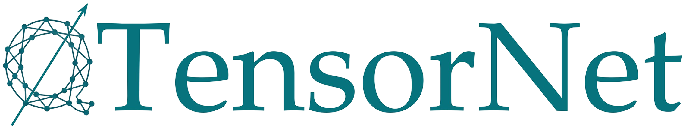

# QTensorNet
This repository contains a cuQuantum-based toolkit designed for many-body problem simulations using tensor networks (TNs).

# Installation

## Prerequisites

Before building QTensorNet, make sure that the following dependencies are installed:

- CUDA >= 13.2
- cuTensor >= 2.8
- cuQuantum >= 26.09
- GCC >= 14
- yaml-cpp >= 0.8.0
- CMake >= 3.20
- MPI built with CUDA support (NVIDIA HPC SDK MPI is recommended)

Make sure that `nvcc`, the MPI compiler wrappers, and the required libraries are available in your `PATH` and `LD_LIBRARY_PATH`.

## Build

Clone the repository and configure the build with CMake:

```bash
git clone <repository-url>
cd QTensorNet
cmake -S . -B build
```

Then compile the project:

```bash
cmake --build build -j
```

# Examples
- **`TEBD1D`** implements the TEBD algorithm using the Suzuki–Trotter decomposition to simulate the dynamics of a local 1D system.
- **`RK1D`** implements the fourth-order Runge–Kutta method using the summation and vector-operator product operations defined for two TNs to simulate the dynamics of a non-local 1D spin network.
- **`DMRGSquareKagome`** and **`DMRGHoneycomb`** apply the DMRG algorithm implemented in QTensorNet to evaluate the eigenvalue problem of non-local 2D spin networks on decorated square-kagome and honeycomb lattices, respectively.
- **`TDVP3DSchrodingerComplete`** and **`TDVP3DvonNeumann`** apply the TDVP algorithm implemented in QTensorNet to simulate the dynamics of a non-local 3D spin network using the Schrödinger and von Neumann equations, respectively.
- **`TDVP2DSchrodingerSquare`** applies the TDVP algorithm implemented in QTensorNet to simulate the dynamics of a 2D spin network on a square lattice using the Schrödinger equation.

# License
This project is licensed under the [CC BY-NC-ND 4.0 license](LICENSE.md).